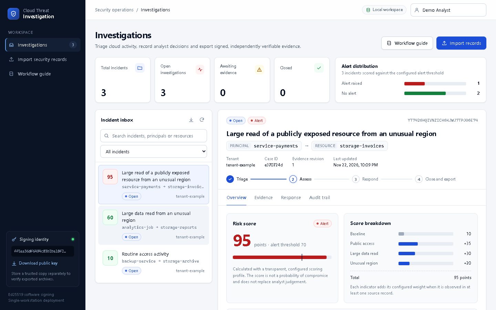
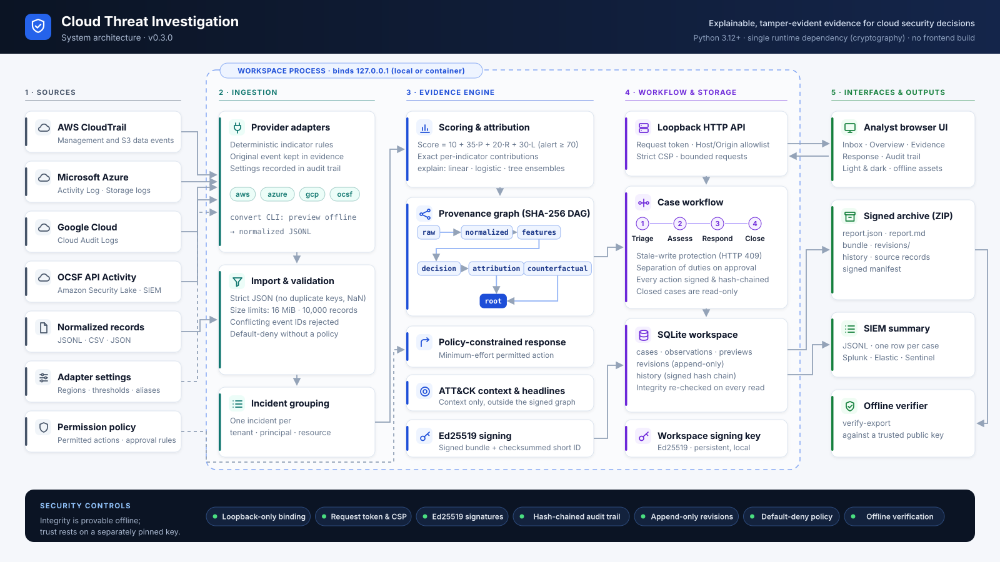

# Cloud Threat Investigation

**Explainable, tamper-evident evidence for cloud security decisions.**

Cloud Threat Investigation is an open-source analyst workspace. It turns cloud security records into investigation cases and explains why each case scored the way it did. It records the analyst's decision and the approved response, then exports a signed archive that auditors can verify offline without access to your systems.



[](https://github.com/AI-Cloud-Security/cloud-threat-investigation/actions/workflows/ci.yml)


---

## Why it exists

Most detection tools raise an alert and stop there. Afterwards, teams struggle to answer:

- **Why was this flagged?** Which records and which indicators drove the score?
- **Who decided what, and when?** What was the analyst's conclusion and rationale?
- **What was changed, and was it allowed?** Was the response permitted by policy and approved?
- **Can we prove none of this was edited later?** This matters for audits, regulators and post-incident reviews.

This project answers all four questions in one workflow and keeps every step in an append-only, signed record.

## Who it is for

| Team | What they get |
|---|---|
| **SOC / incident response** | One guided workflow: triage, assess, respond, close. Every case shows the per-indicator score breakdown and the source records behind it. |
| **GRC, audit & compliance** | Exported archives with signed reports, hash-linked activity history and offline verification. Useful supporting evidence for incident-handling and log-integrity controls. |
| **Security engineering** | Model-neutral evidence format, small readable codebase (~1,000 lines of core Python), one runtime dependency (`cryptography`), no frontend build. |

## Key capabilities

- **Explainable scoring.** Each case shows the baseline and exact per-indicator contributions. Nothing is hidden behind a black box.
- **Content-addressed provenance.** A SHA-256 graph links the raw records, normalized events, features, model profile, policy, decision and explanation to a single evidence root.
- **Policy-constrained response options.** The app only proposes changes that your permission policy allows. It shows the before/after score and never executes a change itself.
- **Signed, append-only history.** Assessments, notes, evidence revisions, approvals, outcomes and closure are Ed25519-signed and hash-chained.
- **Revision-safe evidence.** New records create a new signed revision and require reassessment. Earlier evidence is never overwritten.
- **Offline verification.** `verify-export` checks every file hash, signature, revision and history link against a public key you trust.
- **AWS, Azure, Google Cloud and OCSF import.** Built-in adapters convert AWS CloudTrail, Azure Monitor (Activity Log and Storage logs), Google Cloud Audit Logs and OCSF API Activity exports using explicit, documented rules. The original provider event is kept inside the signed evidence.
- **MITRE ATT&CK context.** Each case lists the related ATT&CK techniques for its indicators, in the UI and in the exported report.
- **Separation of duties.** A policy can require that a different analyst approves the response than the one who assessed the case.
- **SIEM-ready summary.** A one-click JSONL export, with one row per case, for Splunk, Elastic, Sentinel or ticketing tools.
- **Model-agnostic attribution.** `explain` gives exact per-feature contributions for linear, logistic and tree-ensemble models, with confidence intervals where available.
- **Professional local UI.** Light and dark themes, keyboard navigation, accessible labels, and it works offline with no external CDN.
- **Runs anywhere.** Python 3.12+ on Windows, macOS and Linux, or a Docker container.

## Try it in five minutes

Requires **Python 3.12+**.

```bash
git clone https://github.com/AI-Cloud-Security/cloud-threat-investigation.git
cd cloud-threat-investigation

# Windows
.\start.bat
# macOS / Linux
bash start.sh
```

The browser opens at **http://127.0.0.1:8765**. Then:

1. Click **Import records** → **Normalized sample**. This loads three synthetic incidents. (The **AWS CloudTrail**, **Microsoft Azure** and **Google Cloud** buttons load converted provider logs instead.)
2. The highest-risk incident opens: *Large read of a publicly exposed resource from an unusual region* (`service-payments` → `storage-invoices`, 95 points). Review the score breakdown, ATT&CK context and event timeline.
3. Record the assessment **Suspected threat** with a rationale.
4. On the **Response** tab, preview *Disable public access* (95 → 60 points) and approve it.
5. Record the change outcome with a ticket reference, close the investigation as **Resolved** and download the archive.
6. Verify the archive independently:

```bash
python run.py verify-export investigation.zip --trusted-key trusted-public-key.bin
```

Use the `.venv` interpreter for these commands: `.venv\Scripts\python.exe` on Windows, `.venv/bin/python` on macOS/Linux.

Prefer containers?

```bash
docker compose up --build        # then open http://127.0.0.1:8765
```

## How it works



Provider logs and normalized records are converted and validated, grouped into incidents, scored and bound into a signed evidence graph. Analysts then work each case through a signed, hash-chained workflow and export archives that anyone can verify offline. A full-resolution [PNG version](docs/images/architecture.png) is available for slides and documents, and the [architecture guide](docs/ARCHITECTURE.md) describes each component.

**Scoring profile (configurable, not a trained model):**
`10 + 35·public_access + 20·unusual_region + 30·large_read`. The alert threshold is **70**. Scores are transparent risk points, not probabilities.

## Bringing your own data

**AWS CloudTrail, Azure, Google Cloud or OCSF:** choose the record format in the import dialog and attach optional adapter settings (expected regions, large-read threshold, principal aliases). Check the mapping first from the command line:

```bash
python run.py convert cloudtrail trail.json --settings settings.json --summary
```

The [integration guide](docs/INTEGRATION_GUIDE.md) documents every mapping rule.

**Any other source:** import **normalized** records. Each record needs:

| Field | Type | Example |
|---|---|---|
| `tenant` | string | `acme-prod` |
| `event_id` | string, unique per tenant | `evt-7f3a` |
| `timestamp` | ISO-8601 with timezone | `2026-10-31T09:10:00Z` |
| `principal` | string | `service-payments` |
| `resource` | string | `storage-invoices` |
| `action` | string | `read` |
| `public_access` | `0` or `1` | `1` |
| `unusual_region` | `0` or `1` | `1` |
| `large_read` | `0` or `1` | `0` |

```json
{"tenant":"acme-prod","event_id":"evt-7f3a","timestamp":"2026-10-31T09:10:00Z","principal":"service-payments","resource":"storage-invoices","action":"read","public_access":1,"unusual_region":1,"large_read":0}
```

For other sources, such as a SIEM search or another provider, derive the three indicators with your existing detection rules and import the result as JSONL or CSV. JSON Schemas are in [docs/schemas](docs/schemas/). The import dialog includes a CSV template and a permission-policy example. Limits are 16 MiB and 10,000 records per import. Records are grouped by tenant, principal and resource.

A **permission policy** lists which response actions (`disable_public_access`, `limit_read_volume`) are allowed for each principal and resource. It can also set `"separation_of_duties": true`. Without a policy, no response change is offered.

## What's in an exported archive

| File | Purpose |
|---|---|
| `report.json` / `report.md` | Signed machine-readable report plus a human-readable summary with indicators and ATT&CK techniques |
| `bundle.json` | Current evidence bundle: provenance graph, decision, attribution, response analysis |
| `revisions/` | Every historical evidence revision |
| `history.json` | Signed, sequenced, hash-linked activity log |
| `original-records.jsonl` | Source records as imported |
| `policy.json` | Permission policy in force |
| `manifest.json` | Signed SHA-256 manifest of every file |
| `public-key.bin` | Convenience copy only. Verify against a key you trust separately. |

Open cases export as **interim**. Closed cases export as **final**. The [evidence format](docs/EVIDENCE_FORMAT.md) specification lets independent tools verify archives without this codebase.

## Security model at a glance

| Provided today | Not provided (plan these for production) |
|---|---|
| Loopback-only service, request token, same-origin and Host checks, strict CSP | Multi-user login, SSO, authenticated roles |
| Policy-based separation of duties (self-asserted names) | Identity-backed approver enforcement |
| Ed25519 signatures, hash-chained history, append-only DB triggers | HSM/KMS-backed keys, trusted timestamps |
| Offline verification against a pinned public key | WORM retention (e.g. S3 Object Lock) |
| Policy-gated response previews and approvals | Automatic cloud remediation |
| Import validation, bounded inputs, conflict detection | Live cloud connectors |

The signing key is stored unencrypted in `workspace/signing-key.bin`. Back up `workspace/` as a whole while the service is stopped, and never commit it. See [SECURITY.md](SECURITY.md) for the complete trust boundaries.

## Roadmap

Planned directions, in rough priority order. Contributions are welcome.

Delivered in 0.3.0: AWS CloudTrail, Azure, Google Cloud and OCSF adapters, ATT&CK context, separation of duties, a SIEM summary export, a container image and model-agnostic attribution.

1. **Managed signing and trusted time.** AWS KMS, Azure Key Vault, GCP KMS and PKCS#11 signers, plus RFC 3161 timestamps.
2. **Immutable storage export.** S3 Object Lock, Azure immutable blob and GCS bucket lock.
3. **Team deployment.** OIDC sign-in, identity-backed approver roles and a PostgreSQL backend.
4. **Signed evidence for any model family.** Bind logistic, tree and neural detector attributions into the evidence graph.
5. **More adapters.** Azure Entra ID sign-in logs, Kubernetes audit logs and Microsoft 365 audit.
6. **Richer policy graph.** IAM-derived permissions and network-segmentation constraints.

## Command reference

```bash
python run.py                                   # start the workspace (default port 8765)
python run.py --workspace path/to/ws --port 8766 --no-browser
python run.py test                              # unit, workflow, HTTP and signature tests
python run.py check                             # end-to-end import → closure → export → verify
python run.py verify-export case.zip --trusted-key key.bin
python run.py convert cloudtrail trail.json --settings settings.json --out events.jsonl
python run.py explain --model model.json --features features.json
python scripts/check_repository.py              # repository hygiene checks
node scripts/ui_checks.mjs                      # optional UI controller checks (Node.js 20+)
```

Standalone single-bundle tools for engineering checks:

```bash
python run.py create --out runs/case --events events.jsonl --policy policy.json
python run.py verify runs/case/bundle.json --trusted-key runs/case/trusted_public_key.bin
python run.py tamper --data runs/case
```

Install as a package:

```bash
python -m pip install build && python -m build
python -m pip install dist/cloud_threat_investigation-0.3.0-py3-none-any.whl
cloud-threat --no-browser
cloud-investigation-verify investigation.zip --trusted-key trusted-public-key.bin
cloud-threat-convert cloudtrail trail.json --summary
cloud-threat-explain --features features.json
```

## Project layout

| Location | Responsibility |
|---|---|
| `src/cloud_threat/adapters/` | CloudTrail, Azure, Google Cloud and OCSF conversion to normalized records |
| `src/cloud_threat/core/` | Validation, scoring, attribution, ATT&CK context, policy-constrained response search, canonical encoding, provenance, signing |
| `src/cloud_threat/workflow/` | Imports, SQLite store and workflow rules, signing identity, export and verification |
| `src/cloud_threat/web/` | Loopback HTTP API and the HTML/CSS/JavaScript workspace |
| `src/cloud_threat/resources/` | Synthetic datasets, CloudTrail/Azure/Google Cloud/OCSF samples, example models and policies |
| `docs/schemas/` | JSON Schemas for records, policies, adapter settings and summary rows |
| `tests/`, `scripts/` | Unit, workflow, HTTP, integration, UI and repository checks |

## Documentation

- [Quick start](QUICK_START.md): a guided first investigation
- [Operator guide](docs/OPERATOR_GUIDE.md): day-to-day use, backup and recovery
- [Integration guide](docs/INTEGRATION_GUIDE.md): AWS/Azure/Google Cloud/OCSF adapters, policies, SIEM export, Docker, model attribution
- [Evidence format](docs/EVIDENCE_FORMAT.md): signed structures and how to verify them independently
- [Compliance mapping](docs/COMPLIANCE_MAPPING.md): where the output supports ISO 27001, SOC 2, NIST and NIS2/DORA evidence
- [Architecture](docs/ARCHITECTURE.md): components, invariants and evidence format
- [Developer guide](docs/DEVELOPER_GUIDE.md): API, extension points and testing
- [Security model](SECURITY.md): trust boundaries and reporting vulnerabilities
- [Contributing](CONTRIBUTING.md)

## License

Released under the [MIT License](LICENSE).
