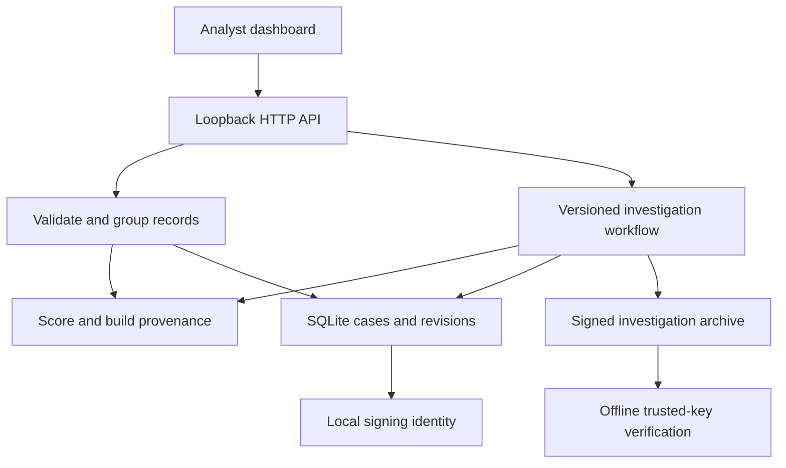

# Application architecture

## User journey and system responsibilities

The application starts with an empty persistent workspace. Imports create incidents, analysts investigate and assess them, permission-bound response previews can be approved, external outcomes can be recorded, and closed investigations can be exported and verified independently.

The browser, API and database share one trusted workstation. The local analyst name is a record label, not an authenticated identity. No cloud execution service sits behind a response approval: the user performs changes externally and records the outcome with a reference.

## Processing and evidence

Imports accept bounded normalized JSONL, CSV or JSON-container records. The whole batch is validated before case writes. Records are deduplicated by tenant/event identity and grouped by tenant, principal and resource. The source-file digest is recorded in signed import activity. JSONL preserves individual record bytes excluding line separators and an initial BOM; CSV and container records receive canonical JSON representation.

For each case, feature aggregation takes the maximum supplied binary indicator across records. A versioned additive scoring profile returns points and exact coefficient contributions. The finite action evaluator checks the saved capability graph and calculates hypothetical feature changes. Original observations remain unchanged by previews.

The content-addressed graph binds raw and normalized observations, features, model profile, permission policy, decision, attribution and counterfactual result. SHA-256 identifies nodes and the evidence root. The encoding sorts ASCII object keys and permits integer numbers; it is a restricted project format rather than RFC 8785.

## Persistence and workflow invariants

| Data | Storage and invariant |
|---|---|
| Cases | Current state and policy, updated in SQLite transactions |
| Observations | Record bytes; an existing event ID cannot be replaced through the API |
| Revisions | Complete signed evidence bundle per revision; UPDATE/DELETE blocked by triggers |
| History | Signed, sequenced hash-chain events containing action details and the resulting case state |
| Response previews | Signed option bound to case, evidence root and revision |
| Signing key | Persistent raw Ed25519 private key in the private workspace directory |

Every command carries the current integer case version. Stale writes return 409. New evidence or policy creates a revision, clears the current assessment/approval/outcome and requires reassessment while preserving earlier signed records. Approval is rejected for a stale evidence root. External outcome recording requires an approval. Resolved closure requires a completed external outcome; expected closure requires an expected assessment; escalation requires a suspected-threat assessment and a reference. Closed cases reject all mutations.

Reads check current evidence, source-record bytes, the signed history chain and agreement between current state and the latest signed state. Export verification also checks every historical evidence revision. Triggers and signatures do not establish administrator-proof storage or prevent replacement with a complete older workspace snapshot.

## Signed export

A ZIP contains `bundle.json`, signed `report.json`, readable `report.md`, `history.json`, `policy.json`, `original-records.jsonl`, `public-key.bin`, all `revisions/` and a signed `manifest.json` with file hashes. Reports from open cases have `final:false`; closed-case reports have `final:true`.

The offline verifier requires a caller-selected public key. It checks archive bounds, file membership and hashes, signatures, graph integrity, history sequencing/hash links, final report/state consistency and evidence revision completeness. It never extracts arbitrary archive paths. It checks integrity under the trusted key, not telemetry truth, signer honesty, model validity or live cloud state.

## Interface and extension boundaries

The browser uses the API documented in the developer guide. It uses separate local HTML/CSS/JavaScript assets without a frontend build or external CDN. Host and Origin checks, a random process token, bounded requests, explicit routes and security headers reduce exposure within the intended local deployment.

Provider-specific acquisition requires authenticated source adapters and an explicit raw-data mapping. Automatic response requires provider adapters, credential handling, idempotency, retry and reconciliation semantics plus independently verified postconditions. Multi-user operation requires authentication, tenant authorization, separate approval roles and a deployment architecture. Hardware keys, trusted time, independent custody checkpoints and enforced retention require their own trust components. None of these are implied by the current local workflow.
