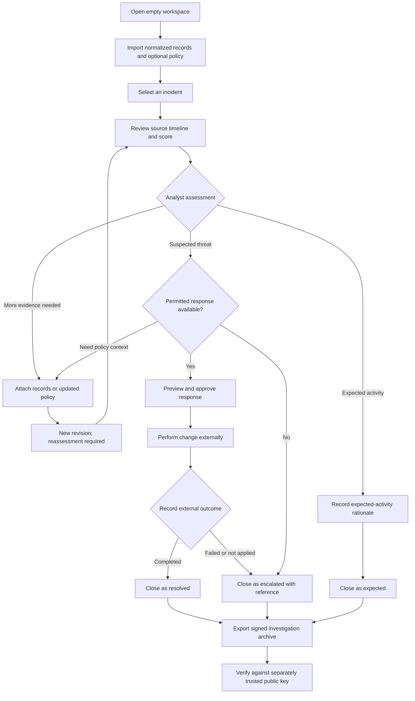

# Analyst journey

The analyst brings a set of security records to investigate an identity's access to a resource. The application organizes the records, explains its configured score, records the analyst's decision and preserves the investigation.

A suspected threat may also be escalated directly with a handoff reference. The diagram shows the primary paths. Open cases can be exported as interim snapshots. Closed cases are read-only, and every evidence revision and recorded workflow action remains available.

An approval records permission for the selected response; it does not execute it. Completion is an analyst statement about an action performed in an external cloud or security console. Use the ticket reference and outcome note to record how completion was checked.
